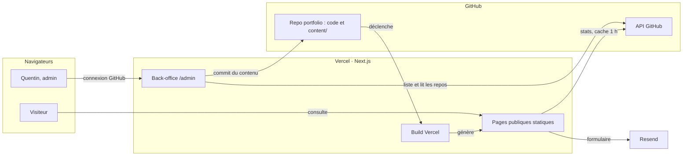
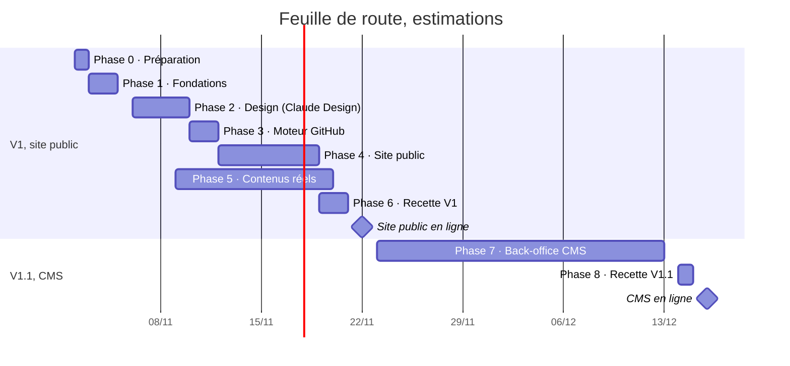

# Plan — Portfolio Quentin (React + CMS GitHub)

> Version publique du plan de réalisation. Les annexes personnelles (environnement de travail, audit des repos privés, coordonnées) restent hors du repo. Dans ce plan, « Toi » désigne Quentin et « Moi » désigne Claude.


Validé le 1er novembre 2026 · Quentin Geoffroy-Pitailler, avec Claude (assistant IA d'Anthropic)

Un portfolio Next.js statique, rapide et accessible, piloté par un back-office privé qui importe tes repos GitHub et publie chaque modification par commit. Cible estimée : site public en ligne vers le Nov 22, 2026, CMS complet vers le Dec 16, 2026.

## Objectifs

Le site doit convaincre un recruteur en 30 secondes et un lead tech en 5 minutes : le portfolio est lui-même ta meilleure preuve de compétence.

- **Recruteur ou RH** : voit tout de suite qui tu es, le poste visé, ta disponibilité, 4 à 6 projets phares, ton CV et un contact en un clic.
- **Lead tech** : ouvre le repo, lance Lighthouse, navigue au clavier, lit l'architecture. Le code du portfolio doit donc être exemplaire : README, décisions documentées, tests, CI.

| Critère | Cible | Mesuré par |
| --- | --- | --- |
| Performance Lighthouse (mobile) | ≥ 95 sur chaque page publique | Lighthouse à chaque PR |
| Accessibilité | WCAG 2.2 AA, 0 violation axe, Lighthouse 100 | axe dans les tests Playwright, tests manuels clavier et NVDA |
| SEO et bonnes pratiques | 100 et 100 | Lighthouse en CI |
| Core Web Vitals réels | LCP < 2,0 s, INP < 200 ms, CLS < 0,05 | Vercel Speed Insights |
| JavaScript au premier chargement | socle Next.js et React mesuré en phase 1, puis 30 ko compressés maximum en plus par page | Lighthouse et l'analyseur de bundle |
| Sécurité | en-têtes notés A+ (B+ minimum, justifié par un ADR), 0 vulnérabilité haute ou critique | Mozilla Observatory, audit des dépendances en CI |
| Qualité du code | TypeScript strict, 0 erreur de lint, ≥ 80 % de couverture sur la logique métier | CI |
| Usage du CMS | ajouter un projet depuis GitHub en moins de 3 minutes | chronométré en recette |

## Ce que fait le site

La V1 publique compte 10 gabarits de pages ; le back-office arrive en V1.1 ; le reste attend la V2.

### Site public (V1)

1. **Accueil** : nom, poste visé, disponibilité et zone (Paris, remote), projets phares, compétences clés, parcours en bref, boutons CV et contact.
2. **Projets** : liste filtrable par techno, par type (perso, école, pro, freelance, hackathon) et « en équipe », recherche instantanée, tri. Les filtres vivent dans l'URL pour partager une sélection.
3. **Fiche projet** : étude de cas (contexte, problème, ton rôle, solution, résultats, apprentissages), captures, stack, liens démo et code, stats GitHub à jour, projets suivant et précédent.
4. **À propos** : bio, expériences, formation, compétences, CV en PDF.
5. **Contact** : formulaire envoyé par email, liens LinkedIn, GitHub et email.
6. **Mentions légales**, **Confidentialité** et **Accessibilité** (déclaration).
7. **404** et **page d'erreur** personnalisées.

Partout : thème clair ou sombre (suit le système, bouton pour changer), mobile d'abord, animations sobres coupées quand l'utilisateur réduit les animations.

### Back-office /admin (V1.1)

1. **Connexion GitHub** : seul ton compte entre, vérifié sur ton identifiant GitHub numérique.
2. **Tableau de bord** : projets avec statut brouillon ou publié, mise en avant, ordre (glisser-déposer plus boutons monter et descendre), état du dernier déploiement.
3. **Import depuis GitHub** : tous tes repos (à toi, en collaboration, d'organisation, privés si validé), recherche, filtres, tri, badge « déjà importé », ajout manuel par `owner/repo`.
4. **Aperçu d'un repo** : toutes les données récupérables, README rendu, stack détectée.
5. **Éditeur de projet** : champs pré-remplis depuis GitHub, chacun modifiable ou laissé synchronisé ; images (upload, recadrage, compression, texte alternatif obligatoire) ; étude de cas en Markdown avec aperçu ; SEO ; prévisualisation de la fiche.
6. **Projets hors GitHub** : création manuelle (site client WordPress, projet sous NDA).
7. **Contenus du site** : profil, expériences, compétences, réglages SEO.
8. **Historique** : chaque enregistrement est un commit lisible et annulable.

### V2, si le temps le permet

Version anglaise (si non retenue en V1), notes techniques en MDX, page « /uses », stats rafraîchies par webhook GitHub, statistiques de visite dans l'admin. Hors périmètre : comptes multiples, commentaires publics, base de données.

## Décisions validées

Validé le 1er novembre 2026 : les 17 décisions sont à OK. Pour en rouvrir une, passe-la à À changer avec un commentaire sur la ligne.

| # | Sujet | Ma recommandation | Alternatives | Pourquoi | Statut |
| --- | --- | --- | --- | --- | --- |
| D1 | Framework | Next.js 16 (App Router, Server Components) | Vite + React en SPA ; Astro + îlots React ; React Router 7 | Pages statiques natives (SEO, perf), admin et API dans le même projet, très présent dans les offres | OK |
| D2 | Stockage du contenu | Fichiers JSON et Markdown dans le repo, écrits par commit via l'API GitHub | Base de données (Neon, Supabase) ; CMS headless (Sanity, Payload) | 0 €, rien à maintenir, historique et retour arrière gratuits ; contrepartie : environ 1 min avant la mise en ligne | OK |
| D3 | Images | Compressées à l'upload (AVIF, WebP), versionnées dans le repo, servies par next/image | Cloudinary ; Vercel Blob | Aucun service tiers ; on reste loin du quota Hobby de 5 000 transformations par mois | OK |
| D4 | Connexion à l'admin | Better Auth en mode sans base (session chiffrée en cookie), fournisseur GitHub, liste blanche sur ton ID | Auth.js v5 (bêta, correctifs seulement) ; OAuth écrit à la main avec jose | Maintenu et sans base de données ; Arctic n'est plus maintenu depuis juillet 2026 | OK |
| D5 | Jetons GitHub | Connexion OAuth sans droit sur tes repos (elle liste tes repos publics, collaborations comprises) ; un jeton fin en lecture seule sur tes repos ; un jeton fin en écriture limité au repo portfolio | Jeton OAuth avec le scope `repo` ; une GitHub App | Aucun jeton n'a à la fois un accès large et le droit d'écrire ; les jetons fins restent en production uniquement | OK |
| D6 | Repos privés dans l'import | Oui pour tes repos privés, via le jeton de lecture, sans lien vers le code ; repo privé d'un camarade : fiche manuelle | Non : repos publics seulement | certains projets privés sont montrables ; le jeton de lecture ne peut rien modifier | OK |
| D7 | Styles | Tailwind CSS 4.3 + tokens maison ; shadcn/ui (Base UI) pour l'admin seulement | Sass + CSS Modules, ton terrain habituel | Rapide et très demandé ; Sass reste possible pour un module vitrine | OK |
| D8 | Langues | Français en V1, structure prête pour l'anglais | Français et anglais dès la V1 (next-intl) | Marché visé en France ; l'anglais double la rédaction | OK |
| D9 | Ordre de réalisation | Site public d'abord (V1), CMS ensuite (V1.1) | CMS d'abord | Les recruteurs voient le site ; le moteur d'import, codé tôt, sert d'abord en ligne de commande | OK |
| D10 | Hébergement et domaine | Vercel Hobby (gratuit) + domaine perso | Netlify ; Cloudflare | Aperçu par PR, analytics sans cookies ; un domaine fait pro sur un CV (10 à 15 € par an) | OK |
| D11 | Node.js et paquets | Node 26 LTS + pnpm 12 | Node 24 (maintenance) ; npm | 26 est la LTS active depuis le 28 octobre ; pnpm bloque les scripts d'installation non approuvés | OK |
| D12 | TypeScript | 6.0 en mode strict | 7.0 (réécrit en Go) | 7.0 n'est pas encore pris en charge par typescript-eslint | OK |
| D13 | Lint et format | ESLint 10 (règles Next.js et jsx-a11y strictes) + Prettier | Biome | 22 règles Next.js contre 12, couverture accessibilité la plus complète ; avertissements de dépendances notés dans un ADR | OK |
| D14 | Tests | Vitest 5, Testing Library, Playwright + axe, MSW 3, Lighthouse 13 en CI | Jest ; Cypress ; Lighthouse CI | Outils actuels ; Lighthouse CI n'a plus publié de version depuis juin 2025 | OK |
| D15 | Formulaire de contact | Server Action + Resend (3 000 emails gratuits par mois), pot de miel et Turnstile | Formspree ; simple lien mailto | Rien n'est stocké par le site ; le journal d'envoi de Resend est déclaré dans la page confidentialité | OK |
| D16 | Analytics | Vercel Web Analytics (sans cookies) + Speed Insights | Umami ; Plausible | Pas de bandeau cookies ; Core Web Vitals réels | OK |
| D17 | Repo du portfolio | `QuentinGP23/portfolio` public : code sous licence MIT, contenus et images tous droits réservés | Repo privé ; ou contenus dans un second repo privé | Le code est un projet vitrine ; contrepartie : tout commit est public, brouillons compris, donc rien de confidentiel dans `content/` | OK |

## Architecture

Une seule application Next.js hébergée sur Vercel : des pages publiques statiques pour les visiteurs, un back-office dynamique et protégé pour toi, et GitHub comme base de contenu.



Le visiteur ne touche jamais l'API GitHub en direct : il lit des pages déjà générées. L'admin lit tes repos et écrit dans le repo du portfolio avec un jeton limité à ce seul repo ; côté public, le serveur relit seulement les stats des repos publics, au plus une fois par heure.

### Stack et versions

Versions stables relevées sur le registre npm le 1er novembre 2026 et revérifiées à l'installation le 4 novembre ; je les revérifie au moment de chaque installation.

| Couche | Outil | Version | Rôle |
| --- | --- | --- | --- |
| Runtime | Node.js | 26 LTS | exécution locale, défaut de Vercel |
| Paquets | pnpm | 12.16.1 | installation, scripts, protections supply-chain |
| Framework | Next.js | 16.4.5, correctif de sécurité du 3 novembre | pages, routes, Server Actions, cache |
| UI | React et React Compiler | 19.3.1 et 1.0.0 | composants, mémoïsation automatique |
| Langage | TypeScript | 6.0, strict | types |
| Styles | Tailwind CSS | 4.3.4 | utilitaires, tokens de design |
| Composants admin | shadcn/ui (Base UI) | CLI 4.23.0 | formulaires, dialogues, menus accessibles |
| Animations | Motion | 14.9.0, chargé à la demande | transitions ponctuelles |
| Thème | next-themes | 0.4.6 | clair et sombre sans flash |
| Validation | Zod | 4.6.7 | schémas partagés serveur et navigateur |
| Formulaires | Server Actions + `useActionState` ; React Hook Form 7.91.0 pour l'éditeur de projet | — | saisie et erreurs |
| Connexion | Better Auth | 1.7.15, mode sans base | OAuth GitHub de l'admin |
| GitHub | `@octokit/graphql` et `@octokit/rest` | 9.0.5 et 22.0.1 | lecture des repos, commits |
| Images | sharp | 0.35.5 minimum | réencodage des uploads, JPEG des images de partage |
| Email | Resend | offre gratuite | formulaire de contact |
| Tests | Vitest, Playwright, @axe-core/playwright, MSW | 5.1.0, 1.64.1, 4.14.0, 3.0.3 | unitaires, e2e, accessibilité, simulation de GitHub |
| Audit | Lighthouse | 13.6.0 | scores à chaque PR |
| Lint et format | ESLint, eslint-config-next, Prettier | 10.14.0, 16.4.5, 3.9.10 | qualité et format du code |
| Hébergement | Vercel Hobby | — | builds, CDN, aperçus, analytics |
| Traductions, si FR + EN | next-intl | 4.14.9 | URLs et textes par langue |
| Design | Claude Design | — | maquettes et design system de référence |

## Le CMS GitHub en détail

Le back-office liste tes repos grâce à ta connexion GitHub et à un jeton de lecture, puis enregistre chaque projet en un seul commit dans le repo du portfolio ; Vercel redéploie en une minute environ.

### Trouver un repo

- Une seule requête GraphQL liste tous tes repos : à toi, en collaboration et d'organisation. Testée aujourd'hui avec ton compte : 39 repos, dont 5 privés et 10 appartenant à d'autres comptes, pour 2 points sur 5 000 par heure. En production, ta connexion GitHub doit voir tes repos publics, collaborations comprises (je le vérifie au début de la phase 7 ; sinon, ajout par URL), et le jeton de lecture ajoute tes repos privés ; le repo privé d'un camarade passe par une fiche manuelle.
- `repositoriesContributedTo` seul n'en trouve que 2 : insuffisant, d'où l'usage de ta connexion GitHub.
- Ajout manuel de n'importe quel repo public par `owner/repo` ou par son URL.
- Recherche dans le navigateur, sans réseau : instantanée, tolérante aux accents et aux fautes, sur le nom, la description, les topics et les langages.
- Filtres : propriétaire (toi, collaborateur, organisation), public ou privé, langage principal, fork, archivé, avec démo, avec README, déjà importé.
- Tri : dernière activité (par défaut), étoiles, date de création, nom. Recherche, filtres et tri restent dans l'URL.
- Accessible : liste navigable au clavier, nombre de résultats annoncé aux lecteurs d'écran.

### Données récupérées pour un repo

| Donnée | Source dans l'API GitHub | Sert à |
| --- | --- | --- |
| Nom, propriétaire, URL | GraphQL `Repository` | titre par défaut, lien vers le code |
| Description | GraphQL | accroche par défaut |
| Site de démo (`homepageUrl`) | GraphQL | bouton « Voir la démo » |
| Topics | GraphQL | tags par défaut |
| Langage principal et répartition en % | GraphQL `languages` | barre de langages |
| Dépendances (`package.json`, `composer.json`, `requirements.txt`) | GraphQL `object(expression: "HEAD:…")` | stack détectée : React, Next.js, Tailwind, Three.js, Supabase… |
| README et ses images | GraphQL `object(expression: "HEAD:README.md")` | étude de cas et captures proposées |
| Image de partage du repo | GraphQL `openGraphImageUrl` | couverture par défaut |
| Étoiles, forks, issues ouvertes | GraphQL | stats affichées, rafraîchies au plus une fois par heure |
| Nombre de commits, premier et dernier commit | GraphQL `history` | période du projet, « mis à jour il y a… » |
| Contributeurs et ta part des commits | REST `/repos/{owner}/{repo}/contributors` | ex. « projet d'équipe de 4, 38 % des commits » |
| Licence, releases, fork, archivé, privé | GraphQL | badges et filtres |
| Déploiements et GitHub Pages | REST `/deployments`, `/pages` | lien de démo de secours |

### Éditeur de projet

| Champ | Pré-rempli depuis | Règle |
| --- | --- | --- |
| Titre | nom du repo rendu lisible (`PC_Aeris` devient « PC Aeris ») | requis, 60 caractères max |
| Slug (URL) | titre | unique, minuscules et tirets ; redirection 301 automatique s'il change après publication |
| Accroche | description GitHub | 160 caractères max, sert aussi de meta description |
| Étude de cas (Markdown) | README | trame guidée : contexte, problème, ce que j'ai fait, résultats, ce que j'ai appris |
| Rôle | — | ex. « Front-end, équipe de 4 » |
| Type | propriétaire du repo | perso, école, pro, freelance, hackathon ; « en équipe » se déduit du champ Équipe |
| Période | premier et dernier commit | mois et année |
| Équipe | contributeurs | taille et liens, optionnel |
| Stack | dépendances, langages, topics | tags choisis dans un registre (logo, catégorie) |
| Couverture | image de partage GitHub | requise, format 16:9, texte alternatif obligatoire ou case « décorative » |
| Galerie | images du README | 0 à 12 images, légende et texte alternatif |
| Liens | démo, URL du repo | démo, code (masqué si privé), maquette, article |
| Points forts | — | 3 à 5 puces, chiffrées quand c'est possible |
| Publication | — | brouillon ou publié, mis en avant, ordre |
| SEO | titre et accroche | titre, description, image de partage (générée sinon) |

Chaque champ issu de GitHub a un interrupteur « suit GitHub » ou « personnalisé » : une resynchronisation ne touche jamais un champ personnalisé.

### Enregistrer = un commit

1. Le serveur revérifie ta session puis valide toutes les données avec Zod ; rien de ce qui vient du navigateur n'est cru sur parole.
2. Chaque image part seule dès son ajout, compressée dans le navigateur (Server Actions réglées à 4 Mo, Vercel coupe à 4,5 Mo par requête). Le serveur la réencode (AVIF ou WebP, 2 400 px max, plus un JPEG 1 200 × 630 pour les images de partage), retire les métadonnées EXIF et GPS, puis l'envoie à GitHub comme blob en attente.
3. À l'enregistrement, le JSON, le Markdown et les blobs d'images forment un seul commit via l'API Git Data (arbre, commit, puis mise à jour de `main` sans `force`), avec le jeton limité au repo portfolio : si le repo a bougé entre-temps, l'enregistrement est refusé au lieu d'écraser.
4. Message lisible : `content(projects): update pc-aeris`.
5. Vercel redéploie ; l'admin affiche l'état du déploiement et le lien de la page.
6. Ces commits de contenu passent la protection de `main` par une règle de contournement réservée au rôle admin, et sautent la CI de code. `next build` revalide tout `content/` avec Zod : un contenu invalide fait échouer le build et la version en ligne reste en place.

En local, le même éditeur écrit directement dans `content/` (adaptateur « fichiers ») ; en production, il crée un commit (adaptateur « GitHub »). Une seule interface `ContentStore` pour les deux : testable, et un bon sujet d'entretien.

### Stats GitHub toujours fraîches

Les pages restent statiques ; les stats (étoiles, dernier commit) sont relues au plus une fois par heure par le cache de Next.js, sans redéploiement. Si GitHub ne répond pas, la page garde les dernières valeurs connues. Pour un repo privé, la page affiche les valeurs de l'import, réduites aux champs affichés puisque le repo du portfolio est public.

## Modèle de données

Un dossier par projet dans `content/`, validé par des schémas Zod qui servent à la fois aux types TypeScript, à l'éditeur et à la CI.

```ts
// content/projects/<slug>/project.json  (+ body.md : l'étude de cas)
type Project = {
  slug: string;                        // "pc-aeris"
  previousSlugs: string[];             // anciens slugs, pour les redirections 301
  status: "draft" | "published";       // un brouillon reste visible dans le repo public
  featured: boolean;
  order: number;
  source:
    | { kind: "github"; repo: string; repoId: string; private: boolean; syncedAt: string }
    | { kind: "manual" };
  sync: Array<"title" | "tagline" | "body" | "topics" | "stack" | "homepage" | "period" | "cover">; // champs qui suivent GitHub
  title: string;
  tagline: string;                     // 160 caractères max
  role: string;
  kind: "personal" | "school" | "professional" | "freelance" | "hackathon";
  period: { start: string; end?: string };    // "2025-12"
  team?: { size: number; members?: { name: string; url?: string }[] };  // size > 1 : « en équipe »
  stack: string[];                     // ids du registre content/techs.json
  links: { demo?: string; code?: string; design?: string; article?: string };
  cover: Media;
  gallery: Media[];
  highlights: string[];                // 3 à 5
  seo?: { title?: string; description?: string; ogImage?: Media };  // image de partage en JPEG 1 200 × 630
  github?: GithubSnapshot;             // copie faite à l'import, réduite aux champs affichés si le repo est privé
  createdAt: string;
  updatedAt: string;
};

type Media = {
  src: string;                         // "/media/projects/pc-aeris/cover.avif"
  alt: string;                         // vide seulement si decorative = true
  decorative?: boolean;
  width: number;
  height: number;
  blurDataURL: string;                 // aperçu flou, créé à l'upload
  caption?: string;
};
```

| Fichier | Contenu |
| --- | --- |
| `content/profile.json` | nom, titre, accroche, bio, disponibilité, localisation, email, liens, CV |
| `content/experiences.json` | postes, alternances, stages : entreprise, rôle, dates, missions, stack |
| `content/education.json` | diplômes, écoles, dates |
| `content/skills.json` | compétences groupées : front, outils, back, design, méthodes |
| `content/techs.json` | registre des technos : id, nom, catégorie, logo, lien |
| `content/settings.json` | SEO par défaut, projets de l'accueil, réglages d'affichage |
| `public/media/projects/<slug>/` | couverture et galerie en AVIF ou WebP |

Si le site passe en FR + EN, les champs texte deviennent `{ fr: string; en?: string }` et `body.md` devient `body.fr.md` plus `body.en.md`.

## Arborescence du projet

Le repo `QuentinGP23/portfolio` sépare le contenu (`content/`), le code (`src/`) et la documentation (`docs/`).

```text
portfolio/
├─ .github/
│  ├─ workflows/ci.yml          lint, types, tests, build, e2e, Lighthouse
│  ├─ workflows/codeql.yml      analyse de sécurité du code
│  ├─ dependabot.yml            mises à jour des dépendances
│  └─ pull_request_template.md
├─ .vscode/                     extensions recommandées, Prettier par défaut
├─ content/                     le contenu, écrit par le CMS
│  ├─ projects/<slug>/project.json + body.md
│  └─ profile.json, experiences.json, education.json, skills.json, techs.json, settings.json
├─ docs/
│  ├─ PLAN.md                   ce plan, versionné
│  └─ adr/                      une décision d'architecture par fichier
├─ public/media/                images optimisées
├─ scripts/content-import.ts    import d'un repo en ligne de commande (V1)
├─ src/
│  ├─ app/
│  │  ├─ (site)/                accueil, projets, projets/[slug], a-propos, contact, pages légales
│  │  ├─ admin/                 back-office, rendu dynamique, protégé
│  │  ├─ api/auth/              connexion et retour OAuth GitHub
│  │  ├─ layout.tsx, globals.css, not-found.tsx, error.tsx
│  │  └─ sitemap.ts, robots.ts, manifest.ts, opengraph-image.tsx
│  ├─ components/               ui/ (design system), site/, admin/
│  ├─ features/                 projects/, github-import/, contact/
│  ├─ lib/
│  │  ├─ content/               schémas Zod, ContentStore, adaptateurs fichiers et GitHub
│  │  ├─ github/                client, requêtes, conversion repo vers projet, détection de stack
│  │  ├─ auth/                  session, garde d'accès
│  │  ├─ seo/                   métadonnées, JSON-LD
│  │  └─ env.ts                 variables d'environnement validées
│  └─ proxy.ts                  redirige /admin vers la connexion (confort, pas la sécurité)
├─ tests/                       e2e/, fixtures/ (tes vrais repos), mocks/ (MSW)
├─ CLAUDE.md                    règles pour moi dans ce repo
├─ README.md, LICENSE, .env.example, .editorconfig, .gitattributes, .node-version
└─ next.config.ts, tsconfig.json, eslint.config.mjs, vitest.config.ts, playwright.config.ts, package.json
```

Routes publiques en français (`/projets/pc-aeris`, `/a-propos`) pour le référencement.

## Sécurité

Le site public n'expose rien d'exploitable (pages statiques, aucun secret dans le navigateur) : l'effort porte sur l'admin, les jetons et les dépendances.

- **Versions** : Next.js 16.4.1 au minimum, à cause des failles critiques des React Server Components depuis décembre 2025 (React2Shell, puis d'autres, dont une critique le 14 octobre 2026). On démarre sur le correctif annoncé pour le 3 novembre. pnpm attend 1 jour avant d'installer une nouvelle version ; `next` et `react*` en sont exemptés pour appliquer un correctif le jour même.
- **Secrets** : jamais dans le code, le chat ou les logs ; `.env.local` ignoré par Git, variables Vercel ; validés au démarrage par Zod ; tout module qui touche un secret importe `server-only`.
- **Admin** : session vérifiée dans chaque page, Server Action et route, pas seulement dans `proxy.ts` (la faille CVE-2025-29927 permettait de contourner le middleware). Liste blanche sur ton identifiant GitHub numérique, qui, contrairement au pseudo, ne change jamais.
- **Connexion** : OAuth GitHub avec `state` et PKCE, cookie de session chiffré, `HttpOnly`, `Secure`, `SameSite=Lax`, durée 8 h ; le jeton OAuth, chiffré dans ce cookie, n'a aucun droit sur tes repos et ne peut rien écrire.
- **Jetons** : PORTFOLIO\_WRITE\_TOKEN, en écriture sur le seul repo `portfolio`, et REPOS\_READ\_TOKEN, en lecture seule sur tes repos : deux jetons fins de 1 an avec rappel, déclarés dans l'environnement Production de Vercel uniquement, jamais dans les aperçus où tourne le code des branches Dependabot. Aucun nom ne commence par GITHUB\_, préfixe réservé par GitHub Actions.
- **Server Actions** : protection CSRF native de Next.js (contrôle de l'origine), validation Zod de chaque entrée, tailles bornées.
- **Uploads** : type vérifié sur la signature du fichier, une image par requête, 4 Mo maximum (Vercel coupe à 4,5 Mo), réencodage serveur par sharp qui retire EXIF, GPS et tout contenu piégé, noms de fichiers générés.
- **Markdown** (README importés, études de cas) : pas de HTML brut, rendu assaini (rehype-sanitize), liens externes en `rel="noopener noreferrer"`.
- **En-têtes** : HSTS, `X-Content-Type-Options`, `Referrer-Policy`, `Permissions-Policy`, `frame-ancestors 'none'`, COOP, `poweredByHeader: false`. CSP stricte avec nonce sur `/admin`, rendu à chaque requête (`instant = false`) : testée en phase 1, elle fonctionne. Sur les pages statiques, la CSP par hachage via `experimental.sri` a échoué au test de la phase 1, car les scripts en ligne des React Server Components ne sont pas couverts : les scripts passent donc par `'unsafe-inline'`, note B+ au mieux (Mozilla Observatory n'accorde aucun bonus sous 90), choix justifié par l'ADR 0005.
- **Formulaire de contact** : pot de miel, délai minimal de saisie, Turnstile ; pas de limite de débit en V1, car sans stockage partagé elle ne tiendrait pas entre les instances Vercel, contenu échappé dans l'email.
- **Dépendances et repo** : scripts d'installation bloqués sauf liste `allowBuilds`, Dependabot, audit pnpm en CI, CodeQL, secret scanning et push protection, ruleset sur `main` (PR obligatoire, contournement réservé au rôle admin pour les commits du CMS).
- **RGPD** : analytics sans cookies donc sans bandeau, messages non stockés par le site (Resend garde un journal des envois, déclaré dans la page confidentialité), polices auto-hébergées (aucun appel à Google Fonts), page confidentialité.
- **Erreurs** : messages génériques côté navigateur, détails seulement dans les logs serveur, sans donnée sensible.

Vérifications : Mozilla Observatory (A+ visé), tests e2e des refus d'accès à l'admin (sans session, mauvais compte), revue de sécurité de l'admin en phase 8.

## Performance

Les pages publiques sont générées au build et servies par le CDN : presque tout le travail est fait avant la visite.

- **Rendu** : Cache Components (activés par défaut dans un nouveau projet Next.js 16.4), `'use cache'` avec `cacheLife` pour les stats GitHub, et le garde-fou `ensureStatic` sur les pages publiques : le build échoue si l'une devient dynamique par erreur.
- **JavaScript** : composants serveur par défaut ; JS côté navigateur seulement pour le thème, les filtres, le formulaire et l'admin. React Compiler activé. L'admin est découpé à part : l'éditeur Markdown et le recadreur d'images ne pèsent rien sur le site public.
- **Images** : next/image (AVIF puis WebP, `srcset`, `sizes` justes), chargement différé sauf l'image principale (`preload`), aperçu flou et JPEG de partage générés à l'upload. Fichiers nommés par version et cache de 31 jours : on reste loin du quota Hobby de 5 000 transformations par mois.
- **Polices** : `next/font`, auto-hébergées, 1 ou 2 familles variables, sous-ensemble latin, `display: swap` et métriques ajustées pour un CLS nul.
- **CSS et animations** : Tailwind 4 ne génère que les classes utilisées ; animations en CSS ou View Transitions (stables depuis React 19.3) ; Motion chargé à la demande, seulement si besoin.
- **Navigation** : préchargement des liens visibles, fichiers statiques en cache CDN immuable.
- **Budgets** : le poids du socle Next.js et React, mesuré en phase 1, puis 30 ko de JS compressé maximum en plus par page, et Lighthouse mobile ≥ 95, vérifiés à chaque PR ; Speed Insights mesure les Core Web Vitals des vrais visiteurs.

## Accessibilité

Cible : WCAG 2.2 niveau AA sur tout le site, admin compris, vérifiée automatiquement à chaque PR et à la main avant chaque mise en ligne. Les critères ajoutés en 2.2 sont couverts : aide au même endroit (3.2.6), pas de double saisie (3.3.7), connexion sans test cognitif (3.3.8).

- **Structure** : HTML sémantique (header, nav, main, footer), un seul `h1` par page, titres sans saut de niveau (ceux d'un README importé sont décalés d'un niveau), vrais boutons et vrais liens.
- **Clavier** : lien « Aller au contenu », ordre de tabulation logique, focus toujours visible et jamais masqué par un en-tête collant (critères 2.4.7 et 2.4.11).
- **Contrastes** : 4,5:1 pour le texte, 3:1 pour les icônes, bordures de champs et focus, vérifiés en thème clair et sombre dès les tokens de design.
- **Cibles** : 24 × 24 px minimum (2.5.8), 44 px visés sur mobile.
- **Mouvement** : `prefers-reduced-motion` respecté, aucune lecture automatique, aucun clignotement.
- **Images** : texte alternatif obligatoire dans le CMS, images de l'étude de cas comprises (champ requis, ou case « décorative » qui donne `alt=""`).
- **Formulaires** : labels visibles, erreurs liées au champ (`aria-describedby`, `aria-invalid`), messages clairs, `autocomplete` renseigné.
- **Composants riches** : primitives accessibles (Base UI via shadcn/ui) dans l'admin ; nombre de résultats des filtres annoncé par une région `aria-live`.
- **Glisser-déposer** de l'admin : alternative au clavier et boutons monter et descendre (2.5.7).
- **Langue** : `lang="fr"` sur la page, `lang="en"` sur les passages en anglais.
- **Zoom et reflow** : lisible à 200 % et à 320 px de large sans défilement horizontal (1.4.10), espacement du texte modifiable (1.4.12).

Tests : règles d'accessibilité du lint dans l'éditeur, axe dans chaque test Playwright, Lighthouse accessibilité à 100, puis passage manuel au clavier et avec NVDA sur Windows, VoiceOver sur iPhone et TalkBack sur Android (je te guide) avant chaque mise en ligne. Une page « Accessibilité » déclare le niveau atteint et comment te signaler un problème.

## SEO

Chaque page publique a un titre, une description et une image de partage uniques, des données structurées et une URL propre ; le sitemap part chez Google et Bing le jour de la mise en ligne.

- **Métadonnées** (API Metadata de Next.js) : titre au format « Titre — Quentin Geoffroy-Pitailler, développeur front-end », description de 150 à 160 caractères, URL canonique.
- **Partage** : Open Graph et Twitter Cards ; image générée automatiquement pour chaque projet (titre, stack, couverture en JPEG, car next/og ne lit ni le WebP ni l'AVIF) avec `next/og`.
- **Données structurées JSON-LD** : `Person` sur l'accueil (nom, poste, liens LinkedIn et GitHub, compétences), `ProfilePage` sur À propos, `CreativeWork` ou `SoftwareSourceCode` par projet, `BreadcrumbList`.
- **Indexation** : `sitemap.xml` et `robots.txt` générés, admin en `noindex` par en-tête HTTP, sans entrée dans `robots.txt` (sinon Google ne verrait pas le noindex), redirection 301 si un slug change.
- **Contenu** : au moins 300 mots utiles par étude de cas, mots-clés naturels (« développeur front-end React Paris »), titres qui décrivent.
- **Signaux techniques** : performance et accessibilité au maximum, HTTPS, mobile d'abord.
- **Suivi** : Google Search Console et Bing Webmaster Tools (vérification du domaine, sitemap, erreurs d'indexation).
- **Liens entrants** : LinkedIn (site et section Sélection), README de profil GitHub, CV PDF, signature email.
- **Bilingue**, si retenu : balises `hreflang` et URL en `/en/`.

## Qualité et outillage

Tout ce qu'une machine peut vérifier l'est à chaque PR ; une PR en échec n'est pas fusionnée.

- **TypeScript 6.0 strict** (`strict`, `noUncheckedIndexedAccess`) ; passage à TypeScript 7 quand typescript-eslint le prendra en charge.
- **Lint et format** : ESLint 10 en configuration plate avec `eslint-config-next` (core-web-vitals et typescript) et jsx-a11y en mode strict ; Prettier avec le tri des classes Tailwind ; EditorConfig ; fins de ligne LF imposées par `.gitattributes`, ton PC étant sous Windows. Les plugins inclus dans eslint-config-next déclarent encore ESLint 9 : avertissements acceptés et notés dans un ADR.
- **Tests** :
  - unitaires (Vitest 5) : conversion repo vers projet, détection de stack, schémas, slugs, garde d'accès ;
  - composants (Testing Library) : filtres, recherche, formulaires ;
  - e2e (Playwright sur Chromium, WebKit et mobile) : parcours visiteur et parcours admin, axe sur chaque page ;
  - API GitHub simulée par MSW 3, avec des fixtures tirées de tes vrais repos ;
  - Lighthouse 13 en CI sur next build puis next start, 3 passes, médiane, seuils bloquants ; pas sur les aperçus Vercel, servis en noindex, qui fausseraient le score SEO.
- **Git** : branches `feat/…`, `fix/…`, `chore/…` ; Conventional Commits vérifiés par commitlint ; hooks lefthook (lint et format des fichiers modifiés, contrôle des types) ; PR obligatoire vers `main`, fusion en squash.
- **CI GitHub Actions** : installation pnpm en cache, lint, types, tests unitaires, build, e2e, Lighthouse ; CodeQL chaque semaine ; Dependabot.
- **Aperçus Vercel** : chaque PR a son URL ; tu valides visuellement avant la fusion.
- **Documentation** : README (présentation, stack, architecture, lancement local, scores), un ADR par décision, `CLAUDE.md`, `.env.example` commenté.
- **Versions figées** : `engines.node` à `26.x`, champ `packageManager`, `.node-version`, fichier de lock commité.

## Feuille de route



Mes phases s'enchaînent ; la phase 5, surtout la tienne, avance en parallèle : tu rédiges les contenus pendant que je code. La phase 7 compte trois semaines, car le CMS est le plus gros morceau. Les dates sont des estimations, mises à jour à chaque fin de phase.

## Phases détaillées

Chaque phase se termine par une démo, cette checklist cochée et un débrief de 15 minutes sur ce que tu dois savoir expliquer en entretien.

### Phase 0 — Préparation et accès

- [x] Moi : audit du PC, pnpm 12.16.1, npm réparé, 13 extensions VS Code, Node.js 26.13.0 et Git 2.56.0 installés
- [x] Toi : valider ce plan, ligne par ligne dans le tableau des décisions
- [x] Toi : accepter les mises à jour de Node.js et de Git (fenêtre Windows « Autoriser »)
- [x] Toi : exporter ton profil LinkedIn en PDF et l'ajouter au projet Claude
- [x] Toi : créer ton compte Vercel avec « Continue with GitHub », puis lancer vercel login une fois sur ton PC
- [ ] Toi : choisir le nom de domaine dans ma liste, puis l'acheter
- [x] Moi : créer le repo public `portfolio`, protéger `main` par un ruleset (PR obligatoire, contournement réservé au rôle admin pour le CMS), activer secret scanning, push protection et Dependabot (fait le 1er novembre)
- [x] Moi : signer les commits du repo avec ton adresse GitHub noreply, pour que ton email n'apparaisse pas dans l'historique public
- [x] Moi : créer et lier le projet Vercel, après ton vercel login (fait le 4 novembre)
- [x] Moi : enregistrer le plan validé dans le projet Claude, puis une version sans données personnelles dans `docs/PLAN.md` et `CLAUDE.md`

Terminé quand : plan validé, repo créé, Vercel relié au repo.

### Phase 1 — Fondations techniques

- [x] Moi : Next.js, TypeScript strict et pnpm, structure de dossiers, alias `@/`
- [x] Moi : Tailwind CSS v4, tokens provisoires, polices auto-hébergées
- [x] Moi : lint, formatage, EditorConfig, fins de ligne LF, hooks Git (lefthook) et Conventional Commits
- [x] Moi : Vitest et Testing Library, Playwright et axe, MSW, un premier test de chaque type
- [x] Moi : CI GitHub Actions, CodeQL, Dependabot
- [x] Moi : en-têtes de sécurité, variables d'environnement validées, `server-only`
- [ ] Moi : déploiement Vercel (production sur `main`, aperçu par PR), Web Analytics et Speed Insights
- [x] Moi : README, premiers ADR, `CLAUDE.md`
- [ ] Toi : ouvrir le projet dans VS Code, lancer `pnpm dev`, vérifier que tout tourne
- [ ] Toi : séance de 30 minutes pour expliquer chaque outil et son rôle

Terminé quand : une page d'accueil provisoire est en ligne, CI verte, Lighthouse à 100 partout.

### Phase 2 — Direction artistique et design system dans Claude Design

- [ ] Toi : m'envoyer 3 à 5 portfolios ou sites que tu aimes, 3 adjectifs pour ton image, les couleurs et polices que tu aimes ou détestes
- [ ] Moi : proposer 3 directions dans Claude Design : accueil et fiche projet, en desktop et en mobile
- [ ] Toi : choisir une direction ou en mélanger deux
- [ ] Moi : enregistrer la direction retenue comme design system dans Claude Design (couleurs, typographies, espacements, composants), puis maquetter les autres écrans : projets, à propos, contact et admin
- [ ] Moi : reporter le design system en tokens Tailwind (couleurs clair et sombre aux contrastes vérifiés, typographie, espacements, rayons, ombres, durées d'animation)
- [ ] Moi : composants de base accessibles (Button, Link, Tag, Card, Section, Heading, Badge, ThemeToggle, SkipLink) et une page interne `/styleguide` non indexée
- [ ] Toi : coder ThemeToggle et Card toi-même, je relis
- [ ] Toi : valider sur ton téléphone et ton écran

Terminé quand : direction validée dans Claude Design, design system enregistré, composants testés (axe, clavier, deux thèmes).

### Phase 3 — Contenus et moteur GitHub

- [ ] Moi : schémas Zod et types (Project, Profile, Experience, Skill, Tech, Settings)
- [ ] Moi : `ContentStore` avec l'adaptateur fichiers, lecture au build
- [ ] Moi : client GitHub (GraphQL et REST, reprises sur erreur, limites de débit), requêtes, conversion repo vers projet, détection de stack
- [ ] Moi : script `pnpm content:import <owner/repo>` qui crée un brouillon depuis GitHub
- [ ] Moi : tests unitaires avec des fixtures tirées de tes vrais repos
- [ ] Toi : créer le jeton de lecture `REPOS_READ_TOKEN`, à déclarer dans Vercel en Production uniquement ; en local, j'utilise ta connexion `gh`
- [ ] Toi : valider la sélection de projets à mettre en avant

Terminé quand : `pnpm content:import QuentinGP23/PC_Aeris` produit un projet valide.

### Phase 4 — Site public

- [ ] Moi : mise en page commune (en-tête, navigation, pied de page, lien d'évitement, thème)
- [ ] Moi : Accueil, Projets (filtres et recherche), Fiche projet, À propos
- [ ] Toi : coder les filtres et la recherche de la page Projets, je relis
- [ ] Moi : Contact (Server Action, email via Resend, anti-spam)
- [ ] Moi : Mentions légales, Confidentialité, Accessibilité, 404, page d'erreur
- [ ] Moi : SEO complet (métadonnées, images de partage, JSON-LD, sitemap, robots)
- [ ] Moi : tests e2e et axe sur chaque page
- [ ] Toi : créer le compte Resend et ajouter les enregistrements DNS que je te donne
- [ ] Toi : relire chaque page sur ton téléphone via l'aperçu Vercel

Terminé quand : toutes les pages en aperçu, CI verte, Lighthouse ≥ 95 / 100 / 100 / 100.

### Phase 5 — Contenus réels, en parallèle des phases 3 et 4

- [ ] Toi : photo professionnelle et CV PDF à jour
- [ ] Moi : brouillons des textes (accroche, bio, études de cas) à partir de tes repos, README et LinkedIn
- [ ] Toi : réécrire ou valider chaque texte, c'est ta voix
- [ ] Moi : captures automatiques des démos en ligne
- [ ] Toi : captures des projets sans démo
- [ ] Moi : préparer README, description, topics et lien de démo de tes repos phares (ceux de camarades, avec leur accord)
- [ ] Toi : relire et publier ces améliorations sur GitHub

Terminé quand : 6 à 8 projets complets, profil et CV finalisés.

### Phase 6 — Recette et mise en ligne V1

- [ ] Moi : audit complet (performance, accessibilité, en-têtes de sécurité, SEO, liens morts, orthographe)
- [ ] Toi : tests réels sur Chrome, Firefox, Safari iOS et Android, au clavier, avec NVDA (je te guide)
- [ ] Toi : brancher le domaine sur Vercel (DNS)
- [ ] Moi : Search Console et Bing Webmaster Tools, soumission du sitemap
- [ ] Toi : valider l'accès à Search Console
- [ ] Toi : mettre à jour LinkedIn (section Infos qui date d'avril 2023, email qui ne reçoit plus, projets, lien du site), ta bio GitHub, et épingler tes repos phares

Terminé quand : site en ligne sur ton domaine, checklist de mise en ligne entièrement cochée. C'est le jalon V1.

### Phase 7 — Back-office CMS

- [ ] Toi : créer l'application OAuth GitHub et le jeton d'écriture `PORTFOLIO_WRITE_TOKEN` (valeurs exactes fournies), puis coller leurs secrets dans `.env.local` et dans Vercel, en Production uniquement
- [ ] Moi : connexion (OAuth avec PKCE et state, session chiffrée, liste blanche) et garde sur chaque page et action admin
- [ ] Moi : tableau de bord : liste, ordre, statuts, état des déploiements
- [ ] Moi : import GitHub : liste, recherche, filtres, tri, ajout par URL, aperçu du repo
- [ ] Moi : éditeur : formulaire, Markdown avec aperçu, images (upload, recadrage, compression, alt), stack, SEO, synchronisation par champ, prévisualisation
- [ ] Moi : enregistrement par commit atomique, gestion des conflits, suppression, brouillons
- [ ] Toi : coder l'écriture locale de l'adaptateur fichiers, je relis
- [ ] Moi : édition du profil, des expériences et des compétences
- [ ] Moi : tests e2e de l'admin avec GitHub simulé
- [ ] Toi : recette : importer un vrai projet de bout en bout, chronométré

Terminé quand : tu ajoutes un projet depuis GitHub en production sans toucher au code.

### Phase 8 — Recette et mise en ligne V1.1

- [ ] Moi : audit de sécurité de l'admin (accès sans session, jeton, uploads, CSRF) et revue de code complète
- [ ] Moi : README final avec architecture, captures, scores et une section « Comment j'ai travaillé avec Claude »
- [ ] Toi : validation finale

Terminé quand : CMS en production, audit sans point bloquant. C'est le jalon CMS.

### Phase 9 — Après la mise en ligne, en continu

- [ ] Toi : ajouter chaque nouveau projet via l'admin
- [ ] Moi : relire et fusionner les mises à jour de dépendances
- [ ] Moi, si tu veux : une tâche planifiée mensuelle qui vérifie versions et failles et rappelle l'expiration du jeton
- [ ] Ensemble : prioriser la V2


## Règles de travail que je suivrai à la lettre

Ce bloc sera copié tel quel dans les instructions du projet Claude « Portfolio » une fois le plan validé.

1. Le plan validé fait foi : ce document et sa copie dans le projet Claude ; le repo public n'en garde qu'une version sans données personnelles (`docs/PLAN.md`). Toute déviation est proposée, justifiée et validée par toi avant d'être appliquée.
2. Mes phases s'enchaînent dans l'ordre ; tes tâches (contenus, validations) avancent en parallèle. En début de phase je récapitule les tâches ; en fin de phase : démo, checklist cochée, débrief « ce que tu dois savoir expliquer en entretien ».
3. Avant d'utiliser une librairie ou une API, je vérifie sa version stable actuelle et sa documentation officielle, jamais de mémoire. Toujours la dernière version corrigée.
4. Le code vit sur GitHub (`QuentinGP23/portfolio`). Une tâche = une branche et une PR avec aperçu Vercel ; CI verte obligatoire ; tu valides avant la fusion (squash). Seule exception aux PR : les commits de contenu du CMS, autorisés par un contournement réservé au rôle admin. Jamais d'autre push direct sur `main`.
5. Code, noms, commentaires et commits en anglais (Conventional Commits) ; contenus du site et documentation en français. Le README explique comment nous avons travaillé ensemble, et mes commits portent la mention `Co-Authored-By: Claude`.
6. TypeScript strict, aucun `any` non justifié, zéro erreur de lint ; tests pour toute logique métier ; axe sur chaque page.
7. Sécurité : aucun secret dans le code, le chat ou les logs ; session vérifiée dans chaque page, action et route de l'admin ; validation Zod de toute entrée.
8. Accessibilité WCAG 2.2 AA et budgets de performance non négociables : une PR qui les dégrade est corrigée avant fusion.
9. Bloqué par un droit, un accès, un compte ou une décision : je m'arrête et je te demande, je ne contourne jamais.
10. Sur le PC de Quentin, je ne travaille que dans le dossier du projet ; toute installation globale se fait avec ton accord.
11. Toute décision technique notable devient un ADR dans `docs/adr/`.
12. Je tiens ce plan à jour (cases cochées, décisions, dates) au fil de l'eau.
13. Les maquettes de référence vivent dans Claude Design ; tout écart entre le code et la maquette est signalé et validé par toi.

## Risques et parades

Le vrai risque n'est pas technique : c'est le temps de rédaction des contenus et le périmètre qui gonfle.

| Risque | Probabilité | Impact | Parade |
| --- | --- | --- | --- |
| La rédaction des contenus prend plus de temps que le code | Haute | Retard de la V1 | Phase 5 en parallèle dès la semaine 2 ; je rédige les brouillons |
| Le périmètre gonfle | Haute | Retard | MVP strict, idées rangées en V2 |
| Tu ne sais pas expliquer ton propre code en entretien | Moyenne | Élevé | Débrief par phase, ADR, tu codes toi-même trois parties (phases 2, 4 et 7) |
| Faille dans Next.js ou React | Moyenne | Élevé | Dependabot, correctifs critiques appliqués sous 48 h |
| Un jeton ou un secret fuit | Faible | Élevé | Secrets hors repo, push protection, jetons minimaux, rotation |
| Un jeton GitHub expire | Moyenne | Stats figées ou admin bloqué | Rappel un mois avant, repli sur les valeurs de l'import |
| La minute d'attente après chaque enregistrement gêne | Moyenne | Faible | Prévisualisation instantanée dans l'admin ; en V2, publication sans rebuild par revalidation ciblée |
| Images trop lourdes dans le repo | Moyenne | Moyen | Compression à l'upload, 500 ko max par image, AVIF |
| Conflit entre une édition locale et l'admin | Faible | Moyen | La mise à jour de `main` se fait sans `force` et refuse l'écrasement ; `git pull` avant de coder |
| Régression d'accessibilité ou de performance | Moyenne | Moyen | axe et Lighthouse bloquants en CI |
| Ton PC est éteint ou l'app Claude fermée | Moyenne | Faible | Le repo GitHub fait foi : j'avance dans le cloud sur le repo GitHub (accès déjà en place) et j'ouvre des PR |
| Le site propose des prestations freelance | Moyenne | Interdit par l'offre Hobby (usage commercial) | Pas d'offre de services en V1 ; sinon Vercel Pro ou un autre hébergeur |
| Un brouillon ou une information confidentielle part dans le repo public | Moyenne | Élevé | Rien de confidentiel dans content/ ; snapshot des repos privés réduit aux champs affichés |

## Checklist de mise en ligne

La V1 ne sort que lorsque les 15 cases sont cochées.

- [ ] Domaine branché, HTTPS actif, redirection de `www` vers le domaine nu
- [ ] Lighthouse mobile ≥ 95 / 100 / 100 / 100 sur accueil, projets, fiche projet et contact
- [ ] 0 violation axe, parcours complet au clavier, test NVDA
- [ ] En-têtes de sécurité notés A+ sur Mozilla Observatory, ou B+ justifié par l'ADR sur la CSP
- [ ] Formulaire de contact testé : réception, anti-spam, message d'erreur
- [ ] 404 et page d'erreur vérifiées
- [ ] 0 lien mort
- [ ] Orthographe relue sur toutes les pages
- [ ] Images de partage vérifiées (LinkedIn Post Inspector, aperçu Discord ou Slack)
- [ ] Sitemap soumis à Google Search Console et Bing Webmaster Tools
- [ ] Mentions légales, confidentialité et accessibilité publiées
- [ ] CV PDF à jour et téléchargeable
- [ ] Analytics actifs
- [ ] README du repo avec captures et scores
- [ ] URL du site sur LinkedIn, GitHub et le CV


## Sources

Versions relevées sur le registre npm le 1er novembre 2026 ; statuts et limites vérifiés sur les documentations officielles ci-dessous.

- [Next.js 16 : guide de mise à jour](https://nextjs.org/docs/app/guides/upgrading/version-16)
- [Next.js : mise à jour de sécurité du 14 octobre 2026](https://nextjs.org/blog/nextjs-security-update-october-14-2026)
- [Next.js : limite de taille des Server Actions](https://nextjs.org/docs/app/api-reference/config/next-config-js/serverActions)
- [Next.js : formulaires](https://nextjs.org/docs/app/guides/forms)
- [Next.js : configuration ESLint](https://nextjs.org/docs/app/api-reference/config/eslint)
- [React 19.3](https://react.dev/blog/2026/09/09/react-19-3)
- [Node.js : calendrier des versions](https://github.com/nodejs/Release)
- [pnpm : sécurité de la chaîne d'approvisionnement](https://pnpm.io/supply-chain-security)
- [TypeScript 7.0](https://devblogs.microsoft.com/typescript/announcing-typescript-7-0/)
- [Tailwind CSS : blog](https://tailwindcss.com/blog)
- [shadcn/ui : Base UI par défaut](https://ui.shadcn.com/docs/changelog/2026-07-base-ui-default)
- [Better Auth : sessions sans base](https://www.better-auth.com/docs/concepts/session-management)
- [GitHub : jetons d'accès personnels](https://docs.github.com/en/authentication/keeping-your-account-and-data-secure/managing-your-personal-access-tokens)
- [Octokit sur npm](https://www.npmjs.com/package/octokit)
- [Satori (next/og) : pas de prise en charge du WebP](https://github.com/vercel/satori/issues/273)
- [Vitest 5](https://vitest.dev/blog/vitest-5)
- [next-intl et root params](https://next-intl.dev/blog/nextjs-root-params)
- [Vercel : offre Hobby](https://vercel.com/docs/plans/hobby)
- [Vercel : aperçus servis en noindex](https://vercel.com/kb/guide/are-vercel-preview-deployment-indexed-by-search-engines)
- [Resend : tarifs](https://resend.com/pricing)
- [Mozilla Observatory : barème](https://developer.mozilla.org/en-US/observatory/docs/tests_and_scoring)
- [W3C : WCAG 2.2](https://www.w3.org/TR/WCAG22/)
